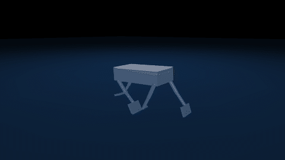
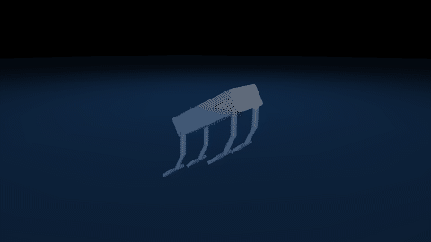
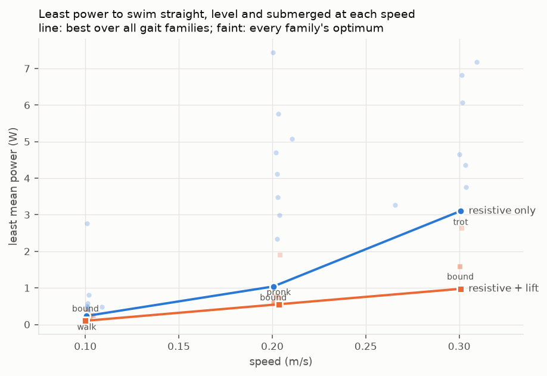
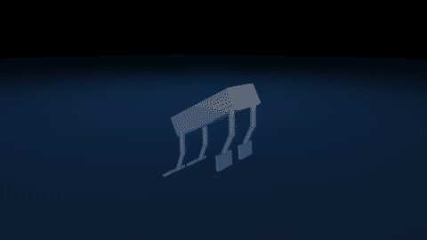

# swimopt

[](https://github.com/lxtuni/swimopt/actions/workflows/tests.yml)

**Find out how a legged robot should swim — automatically.**
Give it a robot model. swimopt adds water forces in MuJoCo and searches for the leg stroke that swims fastest, or uses the least power, while the body stays straight and level.

<table>
<tr>
<td width="50%"></td>
<td width="50%"></td>
</tr>
<tr>
<td align="center"><b>Hand-built gait</b><br>0.07 m/s · rocks 27° in pitch</td>
<td align="center"><b>Optimized by swimopt</b><br>0.47 m/s · straight and level</td>
</tr>
</table>

- **6.8× faster** — same robot, same water, same 400 deg/s servos; about 5 minutes of search on a 16-core laptop
- **2–3× less power** — lift-based strokes need about half to a third of the power of paddling at the same speed
- **Used in a thesis** — the gait study of the swimming quadruped BODY2 → [BODY2-thesis](https://github.com/lxtuni/BODY2-thesis)

*Results use an open toy robot (`toy_quad`); the BODY2 CAD is lab property.*

---

## How it works


1. **Robot model** — any MuJoCo or URDF robot. Changing the robot changes only this file.
2. **Water forces** — every link gets buoyancy, direction-dependent drag, added mass and (optionally) lift, scaled by how much of it is under water.
3. **Leg stroke** — each joint follows a smooth periodic motion; a duty cycle lets the power stroke be faster than the recovery. A motor model keeps it within what real servos can do.
4. **Search** — CMA-ES (a gradient-free optimizer) tries thousands of strokes and keeps the best one.

---

## What it found

**1. Lift beats paddling.** With lift in the model, every optimized gait is lift-driven, and it needs much less power at the same speed.



<table>
<tr>
<td width="50%"></td>
<td width="50%"></td>
</tr>
<tr>
<td align="center"><b>With lift: least power for 0.30 m/s</b><br>0.97 W (best paddling gait needs 3.1 W)</td>
<td align="center"><b>Paddling only: fastest gait</b><br>0.47 m/s, but 11.6 W</td>
</tr>
</table>

**2. Bounding is the fastest leg timing** (front legs together, back legs together). It is left–right symmetric, so it does not cost heading or roll.


**3. Every result is checked.** Each run reports peak joint speed, servo saturation, power, and how often a leg leaves the water, so a gait that depends on physics the model does not include shows up immediately. A pytest suite checks the physics, the servo model and reproducibility.

---

## From simulation to the real robot

The model uses literature coefficients, so its numbers are an estimate, not a measurement.
On BODY2, the first hardware test was **1.3–1.6× slower than predicted** ([details](https://github.com/lxtuni/BODY2-thesis)).
The next step — my master's thesis — is to calibrate the model with tank experiments (system identification), find where it can be trusted, and train a controller that transfers to the real robot.

---

## Try it

```bash
git clone https://github.com/lxtuni/swimopt.git
cd swimopt
pip install -r requirements.txt
python view.py config.json --demo      # watch a hand-built gait
python optimize.py config.json 4000    # search for a better one (a few minutes)
python view.py config.json             # watch the result
```

On Windows you can also double-click the numbered `.bat` files, or open the control panel with `python ui.py`.

---

**More:** [full documentation](docs/DETAILS.md) (physics, servo model, gait families, optimizer, limitations) · [中文说明](README.zh-CN.md) · [thesis notes](thesis_notes/)

MIT License
